# 2\_多媒体信息抽取：架构设想

## **前言：从 IOS 工程反推的3条基本原则**

本章描述下IOS工程为什么这么设计。"设计原点"的意思：整套管道的每一条规则，都能往回追溯到这三条原则。当某个组件的设计与原则冲突时，改组件，不改原则。

这三条原则不是凭空构想的，而是从 IOS 工程的实践中反推出来的，也就是"IOS 项目的开发为什么能成"的提炼。规模化管道把语料从一份权威手册扩展到海量爬虫文档后，复杂度上去了，但这三条不许丢。

#### **原则1：少样本数据（文本）的上下文工程约束**

传统 RAG（检索增强生成）的做法是按相似度取回排名前若干的片段，其余内容被*丢弃*。而逆向工程要求逐句覆盖、不能丢失任何内容。可见，以"召回更多片段"为目标的向量检索，与这项任务在根本上就不匹配（）。因此本管道不建向量库，改用「文档分级 \+ 分层管理 \+ 必读清单」的方式组织语料。哪些文档必须通读、读哪些章节，由人工策展和明确规则决定，而不是交给算法去召回。

> IOS 工程里的对应做法：全程没有向量检索。靠 `A320.md` 做内容锚点、`docs/2` 章节映射表做人工索引、必读清单定点通读原文，而不是让算法去召回片段。
> 
> **举例说明：**
> 
> 1）RAG读文档的方式：RAG 的场景是"带着问题找答案"。比如你问"飞行冻结怎么解除"，系统把问题转成向量，从文档库里挑出语义最接近的 3\~5 个片段喂给大模型，其余 99% 的内容这次查询根本不看。
> 2）逆向工程是度文档的方式：项目的场景是"没有具体问题，要把整本手册变成完整的设计文档"。目标决定了它必须逐句读完：手册里任何一句话漏掉，将来设计文档里就缺一块。比如手册里那句：
>        *注意：在飞行冻结期间，大多数模拟飞机系统不受影响，并继续响应机组操作和故障插入……*
> 
> 这句话看似是"补充说明"，但它其实是系统行为的安全边界。RAG 式做法里，它跟你的查询"飞行冻结怎么解除"相似度不够高，就会被丢在召回结果之外。而在逆向工程里，漏掉它就是事故。因此，docs/3 里的"逐句覆盖原则"这条铁律，正是因为踩过这个坑才立的。
> \-\-\> 为什么说"根本上不匹配"
>    • RAG 的前提是：有一个问题，按相似度找少数相关片段，其余丢弃是特性不是缺陷。
>    • 逆向工程的前提是：没有问题，文档本身就是目的，"丢弃"恰恰是最不能做的事。
> 
> 

#### **原则2：输出结构定义**

蒸馏条目的信息结构（schema，即"每条知识必须包含哪些字段、按什么大纲组织"）与章节大纲，必须在接触语料之前定义清楚。知识图谱的形状由逆向目标决定，而不由语料的形态决定。先把资料收一堆、再回头定结构，等于无的放矢。

> IOS 工程里的对应做法：先定规范（`docs/1` 需求计划、`docs/3` HTML 生成规范）和章节大纲，经人工定稿冻结后，才开始逐章产出内容，不是先堆素材再想结构。
> 
> 

#### **原则3：线索不等于证据**

低质量文档只能用来回答"去哪里找"，永远不能作为规格条目的直接来源。这是防止置信度被稀释重要因素。

> IOS 工程里的对应做法：规格内容的来源只认官方手册（`reference/` 语料库只读），其他资料最多用来指路，绝不直接引用。
> 
> 


**范围声明（2026-08-12）：**本文档描述的管道，第一版只处理文档类语料（pdf / ppt / doc / md / txt 等文本载体）。图、视频、音频的多媒体信息抽取是长期方向，不在第一版范围内，其 source 模型与图表页蒸馏规则待后续版本设计。

**语料语言定案（2026-09-10）：**逆向全程以原文文字为标准，译文仅供人阅读与查询定位，不进入证据链。本条是原则三（线索不等于证据）在翻译场景的具体化：译文是对原文的二次生成，属于衍生资料，身份等同线索。注意标准是原文语言，不是某种指定语言。原文为英文就用英文建档入库，原文为中文就用中文建档入库。原文为中文时，其英文译文同样是衍生资料，同样不得作为依据。起因是 IOS 工程的实测教训：用 MinerU 结构化英文手册后，曾以 deepseek 译文作为逆向工作底本，手册 7\.3\.2 节的 slew（以固定速率推移飞机的面板按钮）被译成拖动，下游据译文脑补出地图拖拽重新定位功能，而手册里地图侧实际只有径向菜单，该虚构功能一直混到 HTML 产物评审才被发现。翻译在垂直专业领域的任何偏差，都会沿管道放大成虚构规格。规则定为三条。一，术语抽取、条目蒸馏、冲突仲裁等所有生产动作只读原文及其结构化 MD。二，译文（不论译成何种语言）作为附属产物存放在原文档文件夹内，元信息卡登记其 derived\_from 指向原文档，用途仅限人快速阅读与查询定位，定位后引用必须回原文核对。三，source 指针指向译文文件的条目一律非法（校验规则落点见 §7\.1 非法结构校验）。

## **总体架构图**

## **（****待完善：1、思考资料庞大后，单个表单超过上下文的解决策略是否要用向量索引的方法？交叉验证机制？****）**

基于前言介绍的IOS系统的总结经验，如果数据量更加庞大，种类和相关性的判断也更加复杂，这时候我们需要基于前言介绍的成功经验，同时设想或总结一套更加标准和流程化的工作流来更好的为我们服务。本章节设想的工作流有几个重要的元素，工作流都是对这几个重要元素进行展开，可参考如下举例：

假设一个文件夹里收了 50 篇文档，走完本文档描述的整条链路（收集 → 结构化 → 分级 → 对齐 → 蒸馏 → 把关）之后，手里最终剩下的是下面这些资产。可以把它理解成一个"**用纯文件搭起来的数据库**"：每类产物都有规定的字段结构（相当于接口），靠 ID 互相挂住，用 Git 管理，初期不需要任何数据库软件。

| 产物 | 数量 | 粒度说明 | 内容与作用 |
| --- | --- | --- | --- |
| 文档文件夹：原文 + 结构化 MD + 目录索引 | 50 个 | 每篇文档一个，一一对应 | 未经裁剪的原始语料，只进不出的只读事实库（可理解为"原料仓"） |
| 元信息卡 | 50 张 | 每篇文档一张，存放在各自的文档文件夹内 | 记录该文档"是什么、谁出的、被判去了哪一层"，分级结果回写于此（可理解为"文档名片"） |
| 蒸馏条目 entries.jsonl | 1 份，行数随蒸馏进度增长（数百~数千行） | 全局一份，每条知识一行 | 从主证据/补充证据层逐条蒸出的规格：功能点、UI、流程、接口、约束，每条带来源章节、置信度、状态。整条链路的主产物 |
| 术语登记表 | 1 份 | 全局共享，跨全部 50 篇文档 | 同一个东西在各文档里的所有叫法归一到规范名，含同名异物辨析 |
| 盲区清单 | 1 份 | 全局共享 | 已确认的知识缺口：哪些章节还没蒸出条目、哪些断言查无实据 |
| 冲突记录 | 1 份 | 全局共享 | 文档之间说法不一致的地方，含仲裁结论。"公开资料错了"本身也是情报 |
| 线索层清单：概念提及、断言日志、检索词表 | 3 份 | 全局共享，从全部线索层文档聚合而来 | 粗糙文档压出的线索，只能指路、永远不作数，与证据链隔离 |
| 知识图谱 | 1 份（初期即 entries.jsonl 本身，不装图数据库） | 蒸馏条目的索引 | 记录"谁出自谁、谁依赖谁、谁和谁冲突"，支撑规格/风险/覆盖三类查询 |

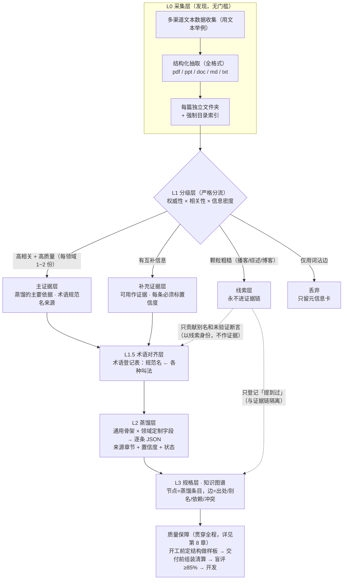

**图表注释**：

- **实线（主流程）**：证据和内容正常流动的方向：采集 → 分级 → 术语对齐 → 蒸馏 → 规格 → 验证。

- **虚线（受限通道）**：线索层的东西不是不能利用，但只能以"线索"身份进入管道，永远不能当证据用。图里两条虚线就是这条警戒线的可视化：

    - 线索层 → 术语对齐层：只提供"别名"（同一个东西的土名、俗称）和"未验证断言"（某文档声称 X 支持 Y），供日后回查。

    - 线索层 → 知识图谱：只登记一条"这篇文档**提到过**这个术语"的关系（图谱Mentions含义：提到的意思），用来以后定向回查，与证据关系（`SUPPORTS` 边，见 §7）严格隔离。


## **采集层（对应上述流程图的LO层级）：数据采集结构化流程**

没有目录的文档等于不存在，目录是后续所有 LLM 定点读取的入口，也是 L1 分级「不读全文」的前提。

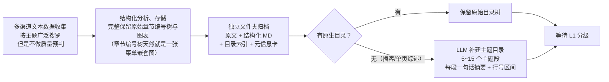

**元信息卡结构：**每篇文档的档案信息，一篇文档对应一张卡，记录这篇文档的基本情况（是什么、谁出的、什么时候来的、篇幅多大、有没有目录）。它跟着文档走，存放在每篇的独立文件夹里。

- **下一章节介绍的分级（L1层）不读全文**：分级只看“卡片 \+ 目录索引 \+ 抽样正文”，卡片里的出品机构、文档类型就是权威性的直接判断依据。没有卡片，每篇都得读全文才能分类，成本就失控了。

- **状态可追**：文档走到哪一步（待分级 / 已分流到哪层），看卡片就知道。

- **合规可查**：来源、收集日期都记在卡上，版权出问题时能追账。

总体来说，它会随流程生长，入库时只登记静态信息（下面的字段）。L1 分级完成后，三个维度的打分和分流结论会回写到卡上。也就是说，卡片不是一次性登记表，而是这篇文档在管道里的全生命周期档案。


**多语言语料的工作语言规则（2026\-09\-10 定案）：**任何语种的原文档，都以其原文文字为唯一工作底本，结构化抽取、分级抽样、术语抽取、蒸馏、仲裁全部只读原文及其结构化 MD。需要其他语种译文时（英文原文档译中文、中文原文档译英文，或其他语种互译），译文身份是阅读辅助产物，与原文同文件夹存放，元信息卡登记 derived\_from 指向原文档。人读译文定位到的内容，引用前必须回原文核对。定案背景与完整规则见前言的语料语言定案。


## **分级层（对应流程图的L1层级）：三个维度打分，分为四个类别**

文档分级就是给每篇文档分类：根据权威性、相关性、信息密度三个维度打分，再按分数把文档分到4个类别：主证据层、补充证据层、线索层、丢弃。

### **3\.1 三个维度的打分标准:**

打分依据：元信息卡 \+ 目录索引 \+ 抽样正文（LLM 只读目录和 3\~5 个抽样段，**不读全文**。分级阶段读全文，成本就失控了）。

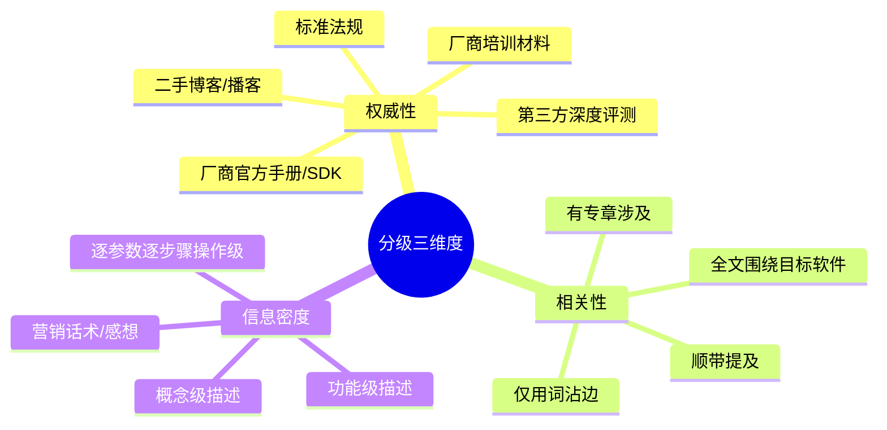


### **3\.2 文本四个分类标签：**

一棵决策树（分流标准），拿来一篇文档，回答三个问题（相关性够吗？是官方操作级吗？有主证据层缺失的信息吗？），产出是每篇文档一个分流结论：主证据层、补充证据层、线索层、丢弃（也就是回写到元信息卡上的那个 `分流` 字段）。

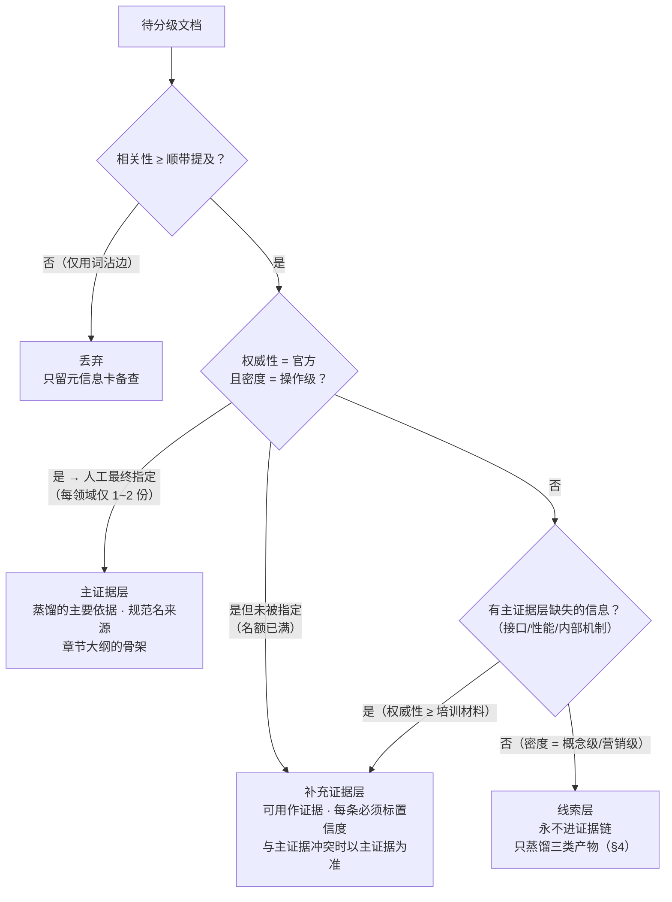

**决策树补充说明：**通过 Q2 但未被指定为主证据的官方操作级文档（每领域主证据名额仅 1~2 份），不降级为线索层，直接进补充证据层。纯重复不等于无价值。同一事实有第二份官方来源背书，相关条目置信度可升至"高"（置信度规则见 §6.2 通用元字段），它是现成的多源印证来源。

### **3\.3 分级自动化路线：同一个标准，由人到机器分三步接管**

本节描述的是"谁来执行3\.2章节的决策树、以及执行方式如何随时间演变"。分流标准不变，只换执行者，分三步走：

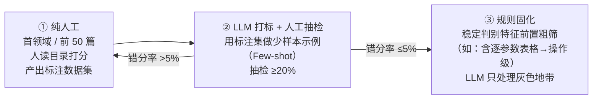

三步各自做什么：

- **第1步骤纯人工**：第一个领域的前 50 篇，由人照着3\.2章节的决策树逐篇判。除了得到 50 个分流结论，还有一个关键副产品：这 50 个人判过的例子本身就是标注数据集，人工标注产出效果如下，标注后多本书就形成了训练集。


元信息卡片


标注后元信息卡片

- **第2步骤LLM 预分级 \+ 人工抽检**：把 步骤1积累下的标注集作为少样本示例（Few\-shot）喂给 LLM，让 LLM 先按同一棵决策树预判，人再抽查 ≥20%。错分率 \>5% 说明 LLM 还没学会，退回步骤1继续攒标注，≤5% 才允许往前走。让LLM自动化分级的提示词可以设计成如下内容，LLM 先按这份说明书预判，人再抽查 ≥20%。错分率 \>5% 说明说明书和例子还不够准，退回 步骤1 继续攒标注。≤5% 才允许往前走。

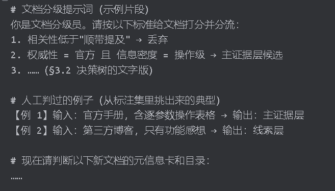


- **第3步骤规则固化**：把已被验证稳定的判别特征（如：含逐参数表格 \-\-\-\> 操作级）变成前置硬规则自动粗筛，LLM 只处理规则拿不准的灰色地带，人工介入最少。


## **线索层详细设计：让粗糙文档安全地贡献价值**

第 3 章的分级结束后，每篇文档的元信息卡上都打好了标签（人工或 LLM 自动打标）。其中被判进"线索层"的粗糙文档（播客、综述、博客），卡片上的故事到此就结束了。标签不会继续追加别的内容。本章回答的是：这批文档还能不能榨出价值？ 答案是能，但榨出来的东西不放在元信息卡上，而是汇总成三份领域级全局清单（与 §5 术语登记表、§6 盲区清单同级别，全领域各一份）。

因为这些产物的价值都在跨文档聚合。单篇博客提一次"教案"没有意义，14 篇文档都提，才说明它是个值得登记的别名。单条断言没有意义，汇总成"待验证问题清单"才能驱动回查。逐篇记在卡上，就永远看不出这些全局模式。判断原则还是那句：记录个体状态的跟着个体走（元信息卡），记录跨个体信息的必须集中（全局清单）。

### **4\.1 三份清单的内容与去向**

| 产物 | 内容 | 举例 | 给谁用 |
| --- | --- | --- | --- |
| 概念提及清单 | 术语/功能名 + 出现频次 + 一句上下文 | 「教案」出现 14 次，上下文都在说 Lesson Plan | 喂给 §5 术语对齐层当别名来源。频次可画出领域热图（哪些概念被讨论最多） |
| 断言日志 | 「某文档声称 X 支持 Y」，状态 = 未验证 | 博客 A 声称 IOS 支持自定义故障脚本 | 进入 §4.2 三态闭环，驱动定向回查 |
| 检索词表 | 俗名/缩写/中英文/行业黑话 | 教案 = Lesson Plan = LP | 下一轮多渠道收集时提高命中率 |

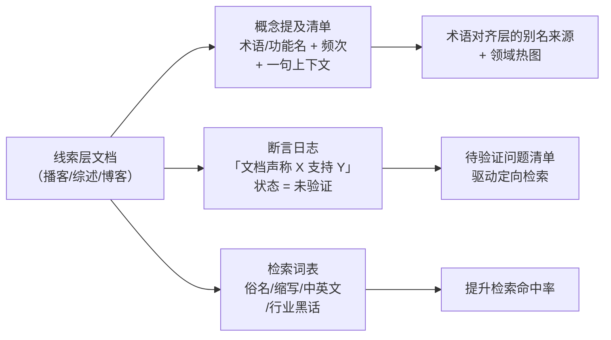

### **4\.2 未验证断言的三态闭环：证实、证伪、查无**

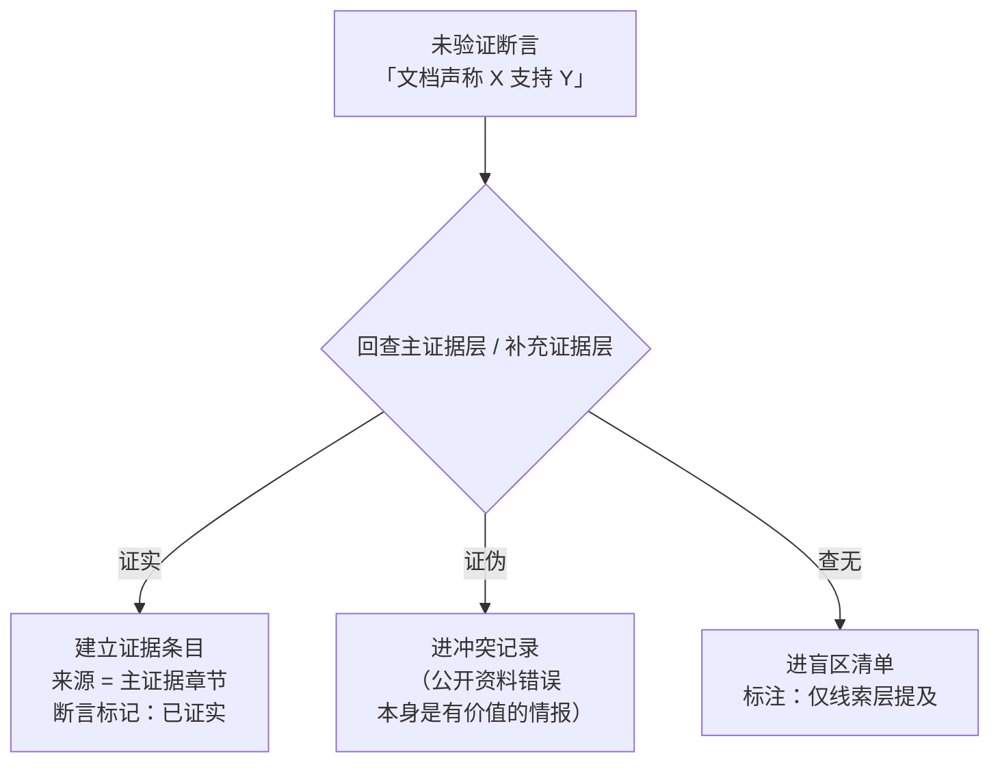

### **4\.3 三份清单的文件格式**

三份清单都是领域级全局文件，全领域各一份，与术语登记表（YAML）、盲区清单（MD）同级，Git 管理。格式按用途定：断言日志要逐条追状态、用 jq 过滤，选 JSONL。概念提及清单与检索词表以词为键、人工翻阅维护多，选 YAML。以下样式可直接照搬建仓。

**概念提及清单（concept\_mentions.yaml）**：按词聚合，回答「这个词在全领域被多少篇文档提过、分别怎么提的」。status 取值：未处理 / 待仲裁 / 已登记别名。

```yaml
- term: 教案
  freq: 14
  status: 已登记别名
  canonical_id: term_lesson_plan
  mentions:
    - doc: podcast_s03e12
      section: seg_07
      snippet: 讲师提到可以直接拿教案生成训练任务
    - doc: blog_review_2025
      section: L120-L134
      snippet: 教案功能藏得比较深
- term: 课程快照
  freq: 3
  status: 待仲裁
  canonical_id: null
  mentions:
    - doc: blog_review_2025
      section: L201-L203
      snippet: 课程快照能存下当时的全部冻结设置
```

**断言日志（assertions.jsonl）**：一行一条「文档声称 X 支持 Y」。status 字段走 未验证 → 已证实 / 证伪 / 查无（查证流程见 §4.2）。resolution 指向终态产物的落点（证据条目 / 冲突记录 / 盲区清单条目），未验证时为 null。

```jsonl
{"assertion_id":"ast_0042","subject":"飞行冻结","claim":"IOS 支持把冻结状态保存进课程快照","source_doc":"blog_review_2025","source_section":"L088-L091","status":"未验证","collect_date":"2026-08-10","check_note":null,"resolution":null}
{"assertion_id":"ast_0031","subject":"OAT","claim":"OAT 上限是 +55°C","source_doc":"training_slide_vendor","source_section":"p17","status":"证伪","collect_date":"2026-08-06","check_note":"cae_ios_manual_v12 §7.4 写明上限 +50°C","resolution":"conflict_0007"}
{"assertion_id":"ast_0057","subject":"VR 视景","claim":"IOS 支持导出 VR 视景配置文件","source_doc":"podcast_s03e12","source_section":"seg_11","status":"查无","collect_date":"2026-08-11","check_note":"主、补充证据层目录索引加全文检索均无相关章节","resolution":"blindspot_0013"}
```

**检索词表（search\_lexicon.yaml）**：俗名、缩写、中英文、行业黑话，供回查与下一轮收集扩词。能挂上登记表的填 canonical\_id，挂不上的留 null 待关联。

```yaml
- word: 室外温度
  type: 俗名
  canonical_id: term_oat
  source_doc: podcast_s03e12
- word: FF
  type: 缩写
  canonical_id: term_flight_freeze
  source_doc: forum_post_881
- word: 课程快照
  type: 黑话
  canonical_id: null
  source_doc: blog_review_2025
```


## **术语对齐层（对应流程图L1\.5 层）：统一跨文档的叫法**

### **5\.1 问题定义**

同一功能在不同文档中叫法不同（"Lesson Plan" / "课程计划" / "教案"），不同功能也可能共用一词（同名异物）。术语对齐错误是整条管道里代价最高的错误：错合并会把两个功能蒸成一个，错拆分会把一个功能蒸成两个，且都极难事后发现。

### **5\.2 核心构件：术语登记表接口**


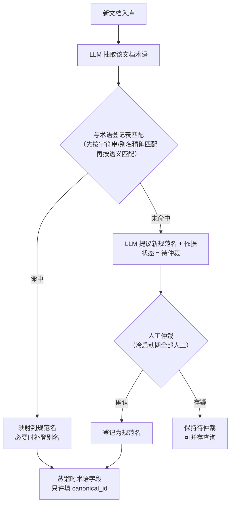

逐步骤讲解（以一批新入库的培训材料为例）：

1）**抽词**：LLM 通读文档，把像术语的词挑出来：功能名、参数名、缩写、UI 控件名，逐个过登记表。

2）**匹配**：每个词先按字符串精确查：它是否等于某条目的规范名、或 aliases 里的某一项。字面查不到时，再由 LLM 按语义判断它是否与某条目是同一物（例如字面不同但意思相同的"课程档案"）。

3）**命中时**分两种处理：

- 这个词**本来就在**规范名或 aliases 里 → 登记表一个字都不用动，直接把它映射到该条目的 canonical\_id。

- 这个词是**没见过的新写法**，但语义判定是同一物 → 映射到该条目的 canonical\_id，同时把这个新写法**补登进 aliases**（下次再遇到就能直接精确命中，登记表越用越全）。

4）**未命中时**（即第一次出现的术语）：LLM 提议一个新规范名并附上依据（出处章节、上下文原句），新建条目、分配 canonical\_id，状态先挂待仲裁，人工确认后转已确认，人工存疑就保持待仲裁、与已确认条目并存可查。注意：第一次出现的词确实会填进规范名，但不是 LLM 直接填，而是LLM 提议 \+ 人工确认后才算数。

5）**回填**：蒸馏时条目的术语字段只许填 canonical\_id，"教案"和"课程计划"在条目层自动汇到同一个 term\_lesson\_plan，后续检索不会漏。

一次实际走查（某培训材料入库，抽出三个词）：

| 抽出的词 | 匹配结果 | 处理 |
| --- | --- | --- |
| 教案 | aliases 精确命中 | 映射到 term\_lesson\_plan，登记表不变 |
| 课程档案 | 字面未命中，语义判定 = 课程计划 | 映射到 term\_lesson\_plan，并把"课程档案"补登进 aliases |
| 燃油冻结（Fuel Freeze） | 未命中 | LLM 提议新条目（附出处与上下文）→ 人工确认 → 登记为 term\_fuel\_freeze，状态转"已确认" |

**铁律：宁可待仲裁，不可错合并。** 合并类操作（两个规范名判为同一实体）**永远人工确认**，即使成熟期也不例外。

**登记原则备注：**宁可待仲裁，不可错合并**。** 合并类操作（两个规范名判为同一实体）永远人工确认，即使成熟期也不例外。


## **蒸馏层（对应架构的L2层 ）：条目结构（Schema）设计**

### **6\.1 结构设计：**

下图描述的是：一条蒸馏条目的结构由 ①② 两层拼成，蒸馏过程还会顺带产出 ③ 三份登记册。整体架构的详解如下：

1）第一阶段含义（通用骨架）：假设知识库中任意一篇文档首先都会蒸馏出很多很多知识条目，每个知识条目都会打一个类型（如：功能点、UI元素、流程、接口、约束），可参考下方表格。

| 从第 7 章拆出的条目 | 归属类型 |
| --- | --- |
| 「OAT 外界温度修改：点字段弹键盘、输入 -70~+50°C……」 | 功能点 |
| 「SLEW 滑动面板：从 Quick Access 区触发、左滑关闭……」 | UI 元素 |
| 「修改参数的通用操作动线：选参数→改值→校验→确认→生效」 | 流程 |
| 「IOS 向模拟器核心发送参数指令的接口约定」 | 接口 |
| 「飞行冻结激活时不允许重新定位」 | 约束规则 |

2）第二阶段含义（领域定制字段）：每种类型配一套自己的字段，如：功能点可以定义 5 个字段（触发方式/输入范围/状态流转/关联依赖/异常边界），UI 元素就定另一套字段（都可以自己配置），比如：触发入口、弹出形式、确认、取消方式、状态反馈4 个，接口又一套，比如：请求参数、响应字段、错误码。类型决定字段表，这就是"② 领域定制字段层"的意思：换领域时，类型清单和每个类型的字段表都要重新设计。

3）第三阶段含义（登记册）：登记册是蒸馏过程的缺口、悬案登记簿，记录的不是已蒸出条目的标记，而是没蒸出来的缺口和不敢拍板的悬案，且与文档是一对多关系（一份文档可能留下多条登记）。蒸馏到一半总会遇到三种当场解决不了的事：

- 手册 §7\.9 提到某参数，翻遍全文没写取值范围 → 记进盲区清单（"§7\.9 XX 参数范围，语料查无"）。它记的是"缺什么"，和 entries\.jsonl 记的"有什么"正好互补，是 §7\.2 覆盖查询（逐句覆盖审计）的依据。

- 手册说 OAT 上限 \+50°C，某培训材料说 \+55°C → 记进冲突记录，事后人工仲裁。

- 博客说的"教案"和手册说的"课程计划"是否同一物 → 记进待仲裁术语。


设计意图：不让悬案阻塞蒸馏主流程，但也绝不允许悄悄放过，先随手记账。下图中 ①→②→③ 的箭头含义：**①→②** 表示通用骨架先套用到具体领域、长出领域定制字段。**②→③** 表示按这两层结构蒸馏的过程中，顺带沉淀出三份登记册（盲区清单、冲突记录、待仲裁术语）。

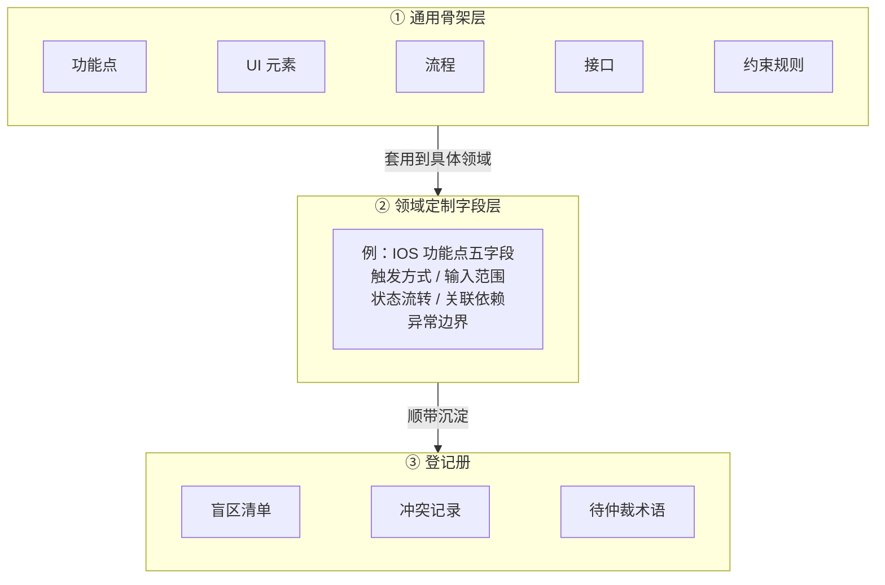


### **6\.2 通用元字段（每条蒸馏 JSON 格式）**


**知识蒸馏举例：两份文档蒸出 5 条**

蒸馏产物全局只有一份 `entries.jsonl`（每条知识一行），不是每篇文档一份文件。假设《CAE IOS 手册》蒸出 3 条、《某厂商培训材料》蒸出 2 条，文件内容就是 5 行（为省篇幅只保留关键字段，完整字段见上方）：


### **6\.3 冲突仲裁规则**

****核心语料从多份文档、多渠道收集后，同一个知识点可能有多份文档给出不同说法。蒸馏时不许挑一个顺眼的或随机找一个说法进行入库，每条结论的出身和等级必须明确，解决不了的冲突必须留痕。按冲突双方的身份，分三种情形（参考3\.2章节描述的分类标签）：

1）**主证据 vs 补充证据**：主证据优先。例：手册写 OAT 上限 \+50°C，某培训材料写 \+55°C → 以手册为准。但如果主证据**根本没提**这个知识点（培训材料独有的信息），则以补充证据为准，置信度降一级，因为它缺了权威背书，用降级的办法把这不是官方说法记录在案。

2）**补充证据 vs 补充证据**：权威性高者优先。如果两份权威性同级却说法不同，不擅自取舍，两条条目都保留，互相标记冲突、记入冲突记录，等后续章节将要介绍的把关环节人工仲裁。宁可并存待判，不可机器拍板。

3）**新证据 vs 旧条目**：语料会增补，条目会过时，这是时间维度上的冲突。规则是旧条目不删除，用`supersedes` 字段指向新条目，规格可以演化，历史不许抹除。这样任何时候都能回答这条规格以前是什么样、什么时候、为什么改的，返工和审计都有据可查。

设计意图：仲裁规则的核心不是选出正确答案，而是每条结论都有明确的出身和等级，解决不了的冲突全部留痕、可追账。这和原则三（线索≠证据）是同一条思路的延伸。冲突不是垃圾，是资产：公开资料里两处说法打架，本身就是值得记录的情报。

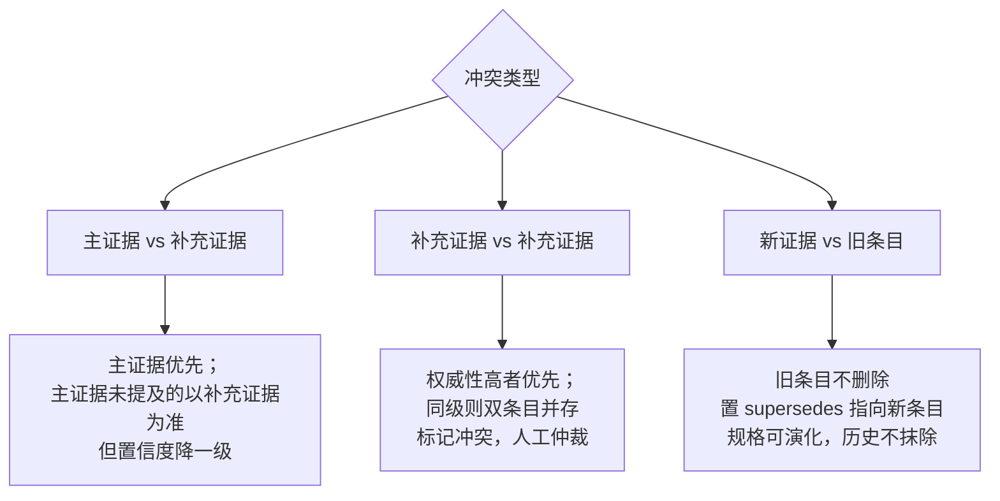

## 

## **规格层（对应架构的L3 层）：知识图谱 = 蒸馏产物的索引**

### **7\.1 图谱的正确角色**

****图谱不是语料仓库，是蒸馏产物的关系索引。 节点只装蒸出来的东西，边只画蒸出来的关系。我们可以把知识图谱理解为存在3种节点，和6种边，节点与边的介绍如下表格：

| 节点 | 描述 | 例子 |
| --- | --- | --- |
| 文档/章节节点 | 主证据层、补充证据层文档的章节（注意是章节级，不是整篇） | 《CAE IOS 手册》§7.4.2 |
| 规格条目节点 | 蒸出来的条目，即 entries.jsonl 里的每一行 | "OAT 外界温度修改"（功能点） |
| 术语节点 | 术语登记表里的规范名 | term\_oat（"OAT 外界温度"） |

| 边 | 描述 | 例子 |
| --- | --- | --- |
| SUPPORTS（出处边，最关键） | 这条条目出自这个章节 | §7.4.2 ─SUPPORTS→ "OAT 修改"条目。有了它，任何规格都能回溯原文摘句，逐句覆盖与出处纪律的落点 |
| ALIAS\_OF | 这条条目使用的规范术语是这个 | "OAT 修改"条目 ─ALIAS\_OF→ term\_oat。条目不直接写术语文字，而是挂到登记表的规范名上，保证全库叫法统一 |
| DEPENDS\_ON | 这条条目依赖那条条目 | "执行重新定位" ─DEPENDS\_ON→ "机场 ICAO 设置"（没设机场就没法重新定位） |
| TRIGGERS | 这个功能点会触发那个流程 | "执行重新定位" ─TRIGGERS→ "飞机位置重置流程"条目 |
| CONFLICTS\_WITH（虚线） | 这两条条目说法打架 | "OAT 上限 \+50°C" ⇄ "OAT 上限 \+55°C"，互相标记，等人工仲裁（§6.3） |
| MENTIONS（虚线，线索专属） | 这篇线索文档提到过这个术语 | 某博客 ─MENTIONS→ term\_oat。只是"提到过"的登记，永远不作证据 |

举例说明：图谱就像图书馆的索引卡片柜，不是书架。书（语料）在文档文件夹里原样存储，卡片柜只记哪条知识出自哪本书哪一节、和谁有关、和谁打架。查书先查卡片，这就是 7\.1 说图谱不是语料仓库，是蒸馏产物的关系索引的意思。节点与边的结构如下，但注意，节点就是3大类：文档或章节本身（包含线索层文档节点）、蒸馏条目（即五类规格条目：功能点 / UI 元素 / 流程 / 接口 / 约束规则，"冲突"不是节点类别，只是条目之间的 CONFLICTS\_WITH 边）、术语节点：

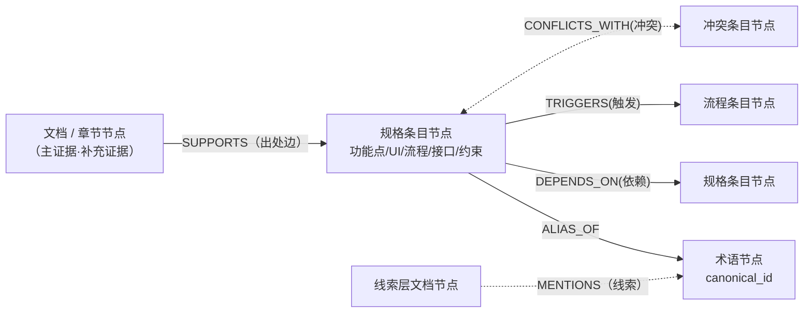

**补充说明：**

**1）ALIAS\_OF边：**有时候同一个内容，在不同文档叫法不同，比如**外界温度**这个词，手册写的是**OAT**，但是培训材料写外界温度等。这样当搜索外界温度就找不到OAT的相关内容信息，导致搜不全。或者两个内容不同的东西交了同样的专业名词，就会把两个完全不同内容混为一谈。所以用这条边说明的是：蒸馏条目不直接写属于文字，而是用ALIAS\_OF指向属于登记表里的规范节点名（参考上文5\.2章节描述的key：canonical\_id，这个关键词是根据不同词汇提炼的一个全局文档最统一的叫法），别名登记表的规范名下边还记录着真实出处、各个文档的不同叫法等信息，就不会搞错了。

**2）实线、虚线含义**：实线术语证据链内的绑定，关系是确认的，直接可以当依据使用。虚线就是未定论的关系。总结来说就是看到虚线可以理解这条关系不能当做依据。

**3）非法结构校验：**任何规格条目无 `SUPPORTS` 边即非法。任何 `SUPPORTS` 边起点为线索层文档即非法。两条均由校验器强制**，**可以理解为：1、任何规格条目必须有 SUPPORTS 边，没有出处的条目就是非法条目（原则三的落点：不许凭空出现据说是的知识），2、 SUPPORTS 边的起点不许是线索层文档（必须实线），线索只能走 MENTIONS 边连到术语节点，永远碰不到条目。3、任何规格条目必须有 ALIAS\_OF 边，每条至少挂一个规范术语，主术语一个、相关术语可多条（如"OAT 修改"主挂 term\_oat，另挂 term\_flight\_freeze）。新术语必须先走 §5\.2 的登记流程拿到编号（哪怕状态是"待仲裁"），不许写自由文本。4、任何规格条目的 `SUPPORTS` 边起点为译文文件即非法，出处必须指向原文档或其结构化 MD（依据前言语料语言定案，2026\-09\-10）。

知识图谱demo如下图所示：


### **7\.2 三类逆向查询（图谱存在的全部理由）**

逆向查询的意思是：就是建好数据库与知识图谱后的日常最常见的使用。不是从文档出发找内容，而是从开发问题出发，反查出对应的知识。三类查询分别回答开发前最常问的三个问题。初期不装图数据库，下面每条都给出基于 JSONL 文件的实操办法（grep / jq）：

**1）规格查询："X 功能的完整规格是什么？"**（开发前取料）

使用者输入提示词进行知识询问流程：开发前想问外界温度（OAT）的完整修改规格，系统里实际发生5步：

① **客户写提示词：**查一下外界温度怎么改，写俗名、外文、缩写都可以，后面有登记表兜底。

② **LLM 抽词，登记表翻译：**LLM 只做一件事，从提示词挑出术语词"外界温度"。然后拿这个词去查术语登记表，先按字符串精确查规范名（canonical\_id）和 aliases，查不到再由 LLM 按语义判断（比如你写的是室外温度），命中后得到规范编号 `term_oat`（这个就是canonical\_id规范名）。注意：翻译靠查表，不靠 LLM 猜，猜可能猜错，查表是确定的（如果字符串匹配不到，也要靠LLM进行圈定范围的）。如果表里彻底查无，这本身就是情报：要么是新术语该登记了，要么是知识库的盲区，系统会明说"没有"，而不是硬捞几段"最像的"强行推送（先字符串查表 \-\> 查不到再 LLM 语义判断 \-\> LLM 也判不出，才算"彻底查无"。只有走到第三步，"查无"才成立。前两步任何一步命中，都不会走到这）。

③ **按编号捞条目**。拿 `term_oat` 去 entries\.jsonl 里精确匹配 `canonical_term` 字段：`jq 'select(.canonical_term=="term_oat")' entries.jsonl`，这个功能蒸出来的所有条目一次捞全。这一步没有 LLM、没有相似度，就是等值匹配，所以不漏、不错捞。

④ **补全上下文**。捞出的每条条目都带着全部家当：结构化字段（触发方式、输入范围、状态流转……）和 source 里的原文出处。想更全，沿 `DEPENDS_ON` / `TRIGGERS` 边把"它依赖谁、它会触发谁"的关联条目也捞出来。觉得哪条不够细，顺着 source 的 doc\+section 回原文那一节读上下文。

⑤ **LLM 组织语言回答**。最后 LLM 把这批条目整理成语句通顺的答案反馈给使用者。它不是自由发挥，是整理已有条目，每句话都对应库里的条目，每条结论都能附上"出自哪份文档哪一节、原文怎么写的"。你看着不对的地方，可以一层层查回原文对质。

一句话记住分工：**登记表管"找到"，蒸馏知识条目管"内容"，source 管"对质"，LLM 只管"听懂"和"组织语言反馈给客户"**。

**重要注释：**对比一下 RAG 的做法，提示词直接向量化，去文档堆里模糊匹配，像什么捞什么，可能漏也可能错捞。这套设计里 LLM 只在两头帮忙（听懂提示词问题的术语、把查到的结果组织成人能理解的顺畅回答），中间的取数动作是确定性查询。登记表就是人话和机器 id 之间的翻译层。图谱里条目为什么用 ALIAS\_OF 边挂到术语节点，查询时就是顺着它走的。还有个顺带的好处：如果你问的词在登记表里彻底查无，这本身就是有价值的情报。要么是新术语（走 §5\.2 未命中流程，登记待仲裁），要么是知识库的盲区。它不会像 RAG 那样硬捞几段最像的造成误会。


**2）风险查询："哪些条目还不结实？"**（使用过程随用随排雷）

库里会存在一些不结实的条目，这不是质量问题，是故意的设计。入库的知识天生结实程度不同，来源有三种。一是出身不同，补充证据层（培训材料、博客）蒸出的条目，单源时置信度就是中，不是它错了，是它缺权威背书。二是推理补全，语料真缺但闭环必需的地方允许补一条，但必须标假设，置信度最高为中（见 §8\.2），它合法进库，但身份是猜的。三是没判完的冲突，手册说 \+50°C 而培训材料说 \+55°C，两条都保留等人工仲裁，仲裁之前都不能全信。

设计的原则是，不许假装确定，也不许丢掉不确定的知识。入库标准若定成百分之百证实，大量有价值的线索只能扔掉。若不标置信度混着放，又会把猜测当事实用。所以选择是都进来，但亮明身份，用的时候按身份区分对待。

排雷的节奏是随用随排，不是建库后先全库排一遍才能用。库建好那天大部分条目就是结实的（主证据层蒸出的条目单源即高置信），为少数拿不准的条目先把全库过一遍，时间花在了暂时用不上的条目上。实际用法是，规格查询捞出某功能的全部条目（比如 8 条），风险过滤只在这 8 条上跑，挑出不结实的当场处理，回原文核对、补找证据、或在规格书上标注待确认，其余条目不碰，每次排雷的范围就是这次用到的范围。排雷也不挡开发的道，不结实的条目带着标记进规格书，开发照做，标记处留到评审时拍板。

过滤条件有三种，各对应一条命令：

- 置信度低：`jq 'select(.confidence=="低")' entries.jsonl`

- 只有单源支持（出处仅一处）：`jq 'select(.source|length==1)' entries.jsonl`

- 涉及冲突：查冲突记录里登记的条目 id（即 CONFLICTS\_WITH 边的两端）

三份结果合并就是开发前的风险清单，这些条目写代码前要么补证据，要么人工复核，避免照着假设写代码，写完才发现是猜的。

随用随排之外还有定期的集中清算。攒下来的冲突记录、盲区清单、低置信条目，在里程碑时（规格书冻结、交付盲评前）由人工集中过一遍，该仲裁的仲裁，该补采的补采，这就是 §8 把关环节干的事。日常靠标记和过滤，定期靠人工清算，两个节奏配合，库是边用边变结实的，不是修好了才许用。

**3）覆盖查询："主证据文档还有哪些章节没蒸出条目？"**（逐句覆盖原则的自动审计）

这条查询回答的问题很朴素，手册一共十二章，蒸到现在，哪章哪节还没动过。它存在的原因是，蒸馏是逐章推进的长期活，中间换过人、停过手、插过新资料，漏掉一两节是常事，而且漏得无声无息，没人提醒就一直缺着，等开发用到才发现规格书凭空少了一块。

什么时候用。它不随每次开发任务跑，是定期的审计动作，主要三个时刻。一是一批文档蒸馏告一段落时，查一遍，确认没有章节被悄悄跳过。二是规格书冻结、交付盲评前，这是 §8 把关环节的必做项，差集必须清零或全部有登记。三是新资料入库蒸完后，确认新增文档的章节也都进了条目。

怎么用，分三步。① 从主证据目录模板（spine\_toc）拿出全章节清单，这是应该覆盖的完整范围。② 把 entries\.jsonl 里所有 source\.section 去重，得到已覆盖清单，一条命令的事：`jq -r '.source[].section' entries.jsonl | sort -u`。③ 两份清单相减，差集就是没蒸的章节。比对可以用小脚本，章节不多时肉眼对也行。

差集里的每一节只有两种合法归宿。一是补蒸，确实漏了就回头把它蒸出来。二是登记盲区清单，写明已读、确无知识可蒸，比如前言、版权页这类读过但确实没有可蒸知识的页面，登记后这一节就算有了交代。纯示意图页不算此类，第一版不蒸图页，图页统一登记为「已知缺口：图信息未蒸，待多媒体版本」，避免被误读为图上无知识。不允许有第三种状态，无声无息地跳过。

这条查询能成立，靠的是 §6\.2 的字段红线，source 必须到章节级。出处都落到了节，覆盖审计就是顺手的事，不需要额外记账。它是 §0 原则一逐句覆盖的落地手段，没有它，全覆盖只是一句口号。

### **7\.3 存储选型（够用即可，不提前投入）**

**初期严禁上图数据库**。蒸馏产物本身就是 JSONL 文件 \+ 术语登记表 YAML \+ 盲区清单 MD，Git 管理即可完成全部三类查询（grep / jq / 脚本）。条目数 \>5000 或需要可视化探索时，再迁 Neo4j。JSONL 的 id 体系就是迁移的种子。（这就是 YAGNI 原则：不为未来可能用不上的需求提前投入。）


## **质量保障：贯穿全程的把关与纪律**

第 2 到 7 章是先后衔接的工序，本章不是第 7 章之后的下一道工序。本章讲的是质量管理，活动分散在整条时间线上，开工前、干活中、交付前各有自己的事。它们回答同一个问题，干活的主力是 LLM，LLM 会犯错，而且错起来是批量地错，一个理解偏差会复制到几百条产物里，人在什么时候、用什么方式把质量接住。

本章各组成部分不是同一类东西。定条目结构（如6\.1章节提及的：功能点、UI元素、流程、接口、约束）、做金样板是开工前的准备工作。返工和推理补全是干活中的生产纪律。组装规格书、清单清算和盲评是交付前的事。其中只有清单清算和盲评是真正意义上的把关，其余都是预防和规矩，这一点旧版本的写法没有说清楚。

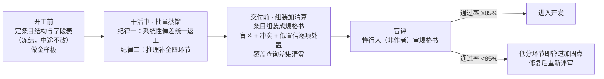

### **8\.1 建立知识库前：定条目结构、做金样板**

**定条目结构，冻结后中途不改：**开工前先把 第6章节涉及的蒸馏条目结构定稿，条目分哪几种类型，每种类型填哪几个字段，置信度和状态的取值规则，全部定死。这是批量蒸馏的模具，模具不稳，几千条条目互相对不上，后面的图谱索引和三类查询全受影响。设计字段表时心里要有最终规格书的样子，规格书想讲状态流转，字段表里就得有这个字段。定了之后发现要改，不拦着，但必须走 §8\.2 的返工机制，先改规范再统一返工受影响条目，不许悄悄改。

**做黄金样板：**每个新领域或新文档类型，先拿 1 到 2 份源文档完整蒸一遍，人工精修到验收标准，再谈批量。它有两个用途，一是给 LLM 当少样本示例（Few\-shot），批量蒸馏照着它学。二是给人工验收当尺子，批量产物跑没跑偏，拿金样板一比就知道。没有金样板就批量，必然系统性跑偏。LLM 对结构的理解来自示例，示例错了，它会把错成批复制到几百条条目里。

### **8\.2 建立知识库过程中：两条生产规则（建库中执行的规则）**

**规则1：**系统性偏差统一返工。批量期发现某类蒸馏知识条目普遍填错某个字段，处理顺序是先修订结构或规范（schema、提示词、字段表），再统一返工所有受影响条目，而不是哪里错了改哪里。受影响范围不用全库排查，条目里的 created\_by 字段记着每条是哪个提取器或提示词版本产出的，按版本号一查就能圈定，返工只动该动的部分。

**规则2：**推理补全按四个环节走。语料不会永远全，有些知识文档里真没有，但闭环又必需，比如手册没写的某个默认值，缺了它规格书连不成完整流程。一刀切禁止推理，规格书就断在这些缺口上。所以设计不是禁推理，是给推理立规矩。

1）触发条件，必须同时满足两条。语料真缺，查过语料和盲区清单确认查无。闭环必需，没有它流程走不通。两条都满足才允许推，防止拿推理当偷懒的捷径。

2）推理依据，不许凭空推。依据只能是已验收的资产或同类模式的类比，比如同类型参数的取值惯例、相邻章节的处理方式。依据要写进条目，不许写据了解、据说这类来路不明的词。

3）显式标注，推理出的条目 status 标假设，confidence 最高为中，假设内容写明。这样它会自动落进风险查询的过滤范围（参考 §7\.2 风险查询），使用时一眼能看到这条是猜的。

4）事后回验，后来补采到真凭实据时回来核对。一致就把假设转正为证据，冲突就按6\.3章节的规则仲裁，并且返工下游引用过这条假设的条目。

一句话，不是不许推理，是推理必须有出处、可被追溯。

### **8\.3 交付前：组装规格书、清单清算加盲评（使用者得到答案）**

**先组装规格书：**规格书不是系统运行时随手生成的回答，是一本定稿的、有目录的逆向说明书（**就是这个系统真正的核心设计要交付的逆向产物**）。知识条目在蒸馏阶段已经全部就绪，脚本把 entries\.jsonl 里的条目按目录顺序排好，每条条目渲染成一节，标题、字段内容、原文摘句、置信度标记依次排开，输出成 md 或 html。组装不产生任何新知识，相当于从数据库导出报表。目录到这个阶段才设计，照搬源文档结构或按开发需要重组都可以。重组也不需要人工建映射表，每条目自带 source 指针，从规格书任何一条内容都能回查到源文档那一节，溯源是条目结构天然给的。

规格书和日常查询的回答不是一回事。日常使用时系统按查询临时生成规格片段（§7\.2 规格查询的五步），随问随答，那是临时输出。规格书是交付前一次性组装的全量定稿，要过下面的清单清算和盲评，冻结后才交付。两者内容同源，区别在范围和验收状态。为什么一定要有这本定稿的书，因为盲评要审一个固定的东西，临时生成的回答千变万化没法验收，只有全量的书摆在那，懂行的人才能通读审查。

**清单清算（规格冻结审核），时机是蒸馏完成后、交付前：**人工逐项过目三份清单，盲区清单、冲突记录、低置信条目清单，逐条决定怎么处理，补采、补蒸、仲裁，或者确认风险可接受、带着标记放行。同时跑一遍覆盖查询（§7\.2），差集必须清零或全部有登记。这就是 §7\.2 说的集中清算，随用随排攒下来的悬案在这里一次清账。清单没有全部处置完，规格书不许冻结。

**盲评，时机是规格书定稿后：**找一个懂行但没参与蒸馏的人审规格书。强调非作者，是因为作者看自己的产物天然觉得都对，幻觉最难自查。盲评问的问题很具体，有没有手册里不存在的功能，状态流转对不对，操作顺序符不符合真实使用。通过率不低于 85% 进入开发，低于 85% 打回，低分的环节正好指出管道哪里需要加固，修完重新评。

## **参考附录：设计点与外部先例对照**

### **9\.1 设计点逐条对照（按正文章节顺序，方便反查）**

| 本文档设计点 | 外部先例 | 相似度 | 来源 |
| --- | --- | --- | --- |
| 逐句覆盖（原则一） | 扎根理论的逐行编码（line-by-line coding，Charmaz）。质性研究要求逐行处理语料，不放任任何一句，防止研究者想当然地跳过 | 同源 | Charmaz 方法介绍 |
| 结构先行（原则二） | 系统综述界的协议预注册。动工前先把研究方案在 PROSPERO 注册冻结，再开始筛文献做提取，防止边看边改标准 | 同源 | PROSPERO |
| 元信息卡（§2.2） | Dublin Core 元数据元素集，15 个元素描述一份资源，1995 年用到现在，国际标准 ISO 15836。机器学习界的 Datasheets for Datasets（Gebru 等，2018）主张每个数据集配一张说明卡，记录出处、收集过程、使用限制，与元信息卡的动机几乎一样 | 同源 | DCMI 官方、Datasheets 论文 |
| 线索不等于证据（原则三）+ 权威性独立打分（§3.1） | NATO Admiralty 信源分级。1939 年英国海军情报处首创，现为 NATO 标准（STANAG 2511）。信源可靠性 A 到 F 与信息可信度 1 到 6 两轴独立打分，未经评估的信息不算情报 | 同构 | Coalition of Cyber Investigators、CERT-EU |
| 分级不读全文，只看卡片加目录加抽样（§3.1） | 系统综述的两级筛选。先按标题和摘要筛掉绝大多数，再对幸存者读全文，PRISMA 流程图把这套漏斗画成了行业标准 | 同源 | PRISMA 筛选流程说明 |
| 四路分流的去留决策（§3.2） | 档案鉴定学。Schellenberg 提出按证据价值与信息价值评估档案，决定留存还是销毁。档案馆一百年的业务就是给文档判生死 | 神似 | NARA 官方博客 |
| 三步走自动化（§3.3） | TAR 预测编码（法律电子证据开示，百亿美元级行业）：人标注种子集、模型预标注、统计抽检控制错分率、规则固化，2012 年 Da Silva Moore 案首开司法认可。ASReview（系统文献综述，Nature Machine Intelligence 2021）：主动学习预排加人工终裁，官网明确拒绝全自动化，理由是 LLM 会幻觉。Snorkel 弱监督（斯坦福，已在 Google、Apple 落地）：把人的判别经验写成代码规则给海量数据打标，对应第③步 | 同构 | eDiscovery Today、ASReview 论文、Snorkel AI |
| 断言三态闭环（§4.2） | FEVER 事实核查基准（NAACL 2018，18.5 万条断言）。每条断言只许标三态：证据支持、证据反驳、证据不足，与本设计的证实、证伪、查无一一对应 | 同构 | FEVER 论文 |
| 术语登记表（§5.2） | SKOS（W3C 推荐标准，2009）。每个概念一个规范名（prefLabel）加若干别名（altLabel），概念用 URI 当永久编号，正好对应规范名、aliases、canonical\_id 三件套 | 同构 | W3C SKOS |
| 条目结构与字段表先行（§6.1、§6.2） | Cochrane 系统综述的数据提取表。每篇纳入研究按预定义字段表逐篇提取，字段表在动工前定稿，各家综述按研究类型各自定制 | 同源 | 提取表实例 |
| 置信度三级（§6.2） | ICD 203 分析标准（美国国家情报总监办公室，2015）。情报判断必须带高、中、低置信度，依据是信息质量与佐证充分度，与本设计按来源定置信度同一思路 | 同源 | ICD 203 原文 |
| 登记册随手记账（§6.1 ③） | 扎根理论的备忘录（memoing）。编码过程中随手记录疑问、缺口、假设，事后再集中清算，不阻塞编码主线 | 神似 | GT 核心特征 |
| 冲突并存不擅自取舍（§6.3） | 情报分析的竞争性假设（ACH，Heuer，CIA）。多个互斥假设并存、逐条对照证据，不急于选定唯一解释 | 神似 | ACH 概述 |
| 历史不抹除（supersedes，§6.2） | 版本管理与审计追踪通例（Git 历史、维基百科修订史），工程常识，无单一出处 | 神似 | — |
| 出处边强制（§7.2） | W3C PROV-O 出处本体（2013 年推荐标准），wasDerivedFrom 关系记录产物出自哪里。Wikidata 要求受争议的陈述必须挂来源，但执行靠社区自觉，本设计靠校验器强制，更严一档 | 同源 | PROV-O、Wikidata 引用指南 |
| 证据边与提及边分开（§7.2） | CiTO 引用类型本体（Shotton，2010）。引用必须分类型，citesAsEvidence（作为证据引用）与 discusses（一般性讨论）是不同属性，对应 SUPPORTS 与 MENTIONS 的分边思路 | 同源 | CiTO 官方 |
| 非法结构校验（§7.2） | SHACL（W3C 推荐标准，2017）。给知识图谱定义形状约束，校验器逐节点强制，违规出具报告。无出处边即非法这条规则，用 SHACL 写就是一个普通约束 | 同构 | W3C SHACL |
| 图谱服务检索（§7） | Microsoft GraphRAG（2024）。LLM 抽实体关系建图谱再服务检索，方向相反：它为召回优化，本设计为覆盖优化。其后续工作 KAG 引入 schema 引导抽取，佐证结构先行 | 对照项 | GraphRAG 论文 |
| 覆盖查询（§7.3） | DO-178C 航电软件认证。强制双向追溯，每个需求追到代码和测试，每段代码追回需求，覆盖分析专查没被验证到的部分。与本项目同属航空语境 | 同源 | DO-178C 介绍 |
| 金样板与抽检（§8.1） | NLP 数据标注界的金标准与一致性指标（Cohen's kappa、Krippendorff alpha）。标注指南先用小批量试标迭代，再大规模铺开 ◇ | 同源 | — |
| 盲评加通过率门槛（§8.3） | 同行评审与制造业验收抽样的思想（抽样检查批次，缺陷率低于门槛才放行）。机制有出处，85% 这个数值是我们拍的，无先例背书 | 神似 | — |
| 按质量分层（§1 的 L0 到 L3） | 数据湖仓的 medallion 架构（Databricks 推广）。bronze 存原始、silver 做清洗、gold 出成品，按质量分层流动是数据工程常识。层的编号与边界划分是本设计自己的 | 神似 | Databricks 官方文档 |
| JSONL 加 Git 够用即可（§7.4） | Unix 小工具哲学与极限编程的 YAGNI 原则，工程通例，无单一出处 | 神似 | — |
| 结构先行的工业先例（原则二补充） | S1000D、DITA 航空技术出版物标准。先定 schema 再写内容，在航空手册领域是工业标准 ◇ | 同源 | — |
| 整体目标（从公开文档逆向规格） | 净室逆向工程。从公开文档与可观察行为推导规格，是法律认可的成熟工程传统 ◇ | 目标层先例 | — |

注解：同构：机制逐条对应，几乎是一个东西，零件能一一对上。同源：核心概念直接对应，但细节有差。

**诚实清单：没找到直接先例、属于本设计自己组合的部分**

- 固定五类骨架（功能点、UI 元素、流程、接口、约束规则）。每一类都能在软件工程文档里找到影子（需求规格、UI 规范、接口文档），但把这五类钉成跨领域复用的固定骨架，没找到现成体系这么干。

- 信息密度作为独立分级轴。权威性和相关性都有八十年的对照实践，按颗粒粗细分级是我们为逆向场景自己加的。

- 线索层三清单里，断言日志有 FEVER 同构，概念提及清单和检索词表没有单一先例，是为这条管道自己设计的聚合产物。

- 主证据、补充证据、线索、丢弃这套命名与边界。档案鉴定只有留与弃，情报分级只有两轴打分，切成四档并各配规则是我们按逆向场景切的。

- 85% 盲评阈值，上面已说。

- 用纯文件加 LLM 从混合语料逆向软件规格这个整体组合。零件几乎都有先例，组装方式是我们自己的。这算工程组合，不必吹成学术创新。也正因为每个零件都被别的行业验证过，组合的实际风险比看起来低。


### **9\.2 链条下半段先例：规整之后蒸出了什么**

9\.1章节的先例大多验证链条上半段（打标、分类、归档）。下面两例验证下半段：规整好的信息能否蒸馏出逆向成果。均已联网核实。

两点贯穿性观察。一，下半段先例全部发生在逆向成果可被执行或验证的领域，价值靠能跑、能验证、能抓 bug 兑现，不靠文档漂亮。二，上下半段所有先例都自带出处回链（OpenFisca 参数引法条、Sail 映射手册段落、Wikidata 争议陈述强制来源），出处纪律是行业最佳实践的标配，本文档的设计不孤立。

### **9\.3 工程价值的冷峻评估**

结论：机制真实有效，工程价值成立。零件层面几乎没有原创，而这恰恰是最有力的外部证据。重组后的对照表显示，法律（TAR）、情报（Admiralty、ICD 203、ACH）、医学（PRISMA、Cochrane、ASReview）、图书馆学（Dublin Core、SKOS、档案鉴定）、语义网（PROV、CiTO、SHACL）各自独立验证了同一套零件，本文档是把它移植到软件逆向场景并做了反 RAG 适配。真正没有先例背书的是几个具体组合与参数（五类骨架、信息密度轴、四路命名、85% 阈值），它们撑不起来引用的腰，只能靠试点实测立起来。

真正的差异化（相对位置，非奉承）：

- 反 RAG 立场在穷尽覆盖任务上是对的。RAG 为问答优化召回率，逆向工程要覆盖率，信息抽取领域公认文档级抽取需要全文通读。

- 出处强制加线索隔离比多数 LLM 抽取方案严格。GraphRAG 不做逐条出处校验，Wikidata 靠社区自觉。

**软肋：**

1. 目前只是方法论合理加单点实证（IOS），缺每条目成本、抽取准确率、盲评通过率的实测数据。e\-discovery 当年是靠严格的成本收益测量赢下行业的。

2. 85% 盲评阈值是拍脑袋的。TAR 用统计抽样和召回率估计，本文档缺标注一致性指标（如 Cohen's kappa）。

3. 不建向量库的绝对化立场，规模化时会反噬。术语登记表的候选匹配天然需要向量索引。建议红线改为向量不作证据来源，而非不用向量。

4. LLM 抽取有系统性错误模式（否定句、条件从句、单位换算），懂行人盲评未必抓得完，冷门领域还找不到懂行人。

5. 每领域 1 到 2 份主证据的假设在很多领域不成立。没有权威手册的领域，分级标准需要重设计。

**护城河的位置：**

1. 建成并验收过的知识库本体。这是库存逻辑，别人重建的成本就等于你建设的成本，一分钱省不了。Sail 的例子就在这，RISC\-V 国际组织不是自己重写一套，而是直接把剑桥的模型收编成官方模型，先用者把位置占了。知识库做出来了并且被信任，这本身就是壁垒。

2. 跑出来的成本和质量数据。你知道 LLM 抽取在哪类句子上翻车，知道人工把关每千条花多少工时，新玩家不知道，他的报价和工期就只能拍脑袋。这是成本曲线上的信息差。


## **TODO · 待优化清单：七个结构性问题（按优先级排序）**

2026-08-11 评审记录，2026-08-12 更新。本节与 §9.3「软肋」不重复：§9.3 是对自身证据与参数的评估，本节是评审发现的架构层缺口，按建议处理的优先级排序。TODO-1 已于 2026-08-12 定案（第一版仅覆盖文档，即多格式文本抽取，多媒体推后），TODO-2 成为剩余唯一决定适用边界的项，错了返工的是全局。TODO-3 ~ TODO-5 决定规模化之后知识库会不会悄悄烂掉。TODO-6、TODO-7 是局部机制补强。总体架构图顶部「待完善」三问在本节的落点：交叉验证机制 → TODO-5。向量索引 → TODO-3 的候选召回（红线不变：向量只出候选、不产证据）。单文档超上下文 → 分块协议随 source 模型一并设计，第一版只需覆盖文本分块。

### **TODO-1（P1）「多媒体」定位与纯文本管道的落差【已定 · 2026-08-12】**

- **问题：**输入格式全是文本载体（pdf / ppt / doc / md / txt）。图谱节点没有图、视频、音频类型。source 指针只有 doc + section，无法指向视频时间戳、图中区域、音频片段。骨架里的「UI 元素」条目天然证据是截图与录屏，SUPPORTS 边却无处落脚。最直接的内证矛盾在 §7.2：覆盖查询把「纯示意图页」列为「确无知识可蒸」的盲区登记示例。工业手册里状态机图、面板图、流程图恰恰承载正文没有的信息，把图页声明为无知识，等于放弃了标题里的「多媒体」。
- **结论（2026-08-12 定案）：**第一版定位收敛为多格式文本抽取，只处理文档，多媒体推至后续版本。「多媒体」作为长期方向保留在标题里，但正文需要补一句第一版范围声明，避免读者按标题预期图、视频、音频能力。多媒体 source 模型（figure_id、时间戳区间、帧 + 区域坐标）与图表页蒸馏规则到多媒体版本再设计，届时本条重新打开。
- **残留动作（正文小改，已于 2026-08-12 执行）：**一，§7.2 覆盖查询把「纯示意图页」当作「确无知识可蒸」的盲区示例，第一版应改登记为「已知缺口：图信息未蒸，待多媒体版本」，避免被误读为图上无知识。二，前言或总体架构章补一句第一版范围声明。

### **TODO-2（P2）目标软件的版本维度缺失**

- **问题：**冲突仲裁规则 1「主证据优先」没有版本前提：2019 年的官方手册 vs 2024 年的培训材料，软件 2022 年升过版，按权威性优先会选错。supersedes 管的是语料演进，不是目标软件本身的演进。§6.2 条目 schema 里没有适用版本字段。后果：软件升大版本时，库里几千条条目没有任何机制回答「哪些还成立」。
- **建议：**条目增加 applicable_version 字段。仲裁规则 1 加「同一软件版本前提下」的限定，跨版本分歧按规则 3 的 supersedes 处理并保留版本标记。

### **TODO-3（P3）条目层缺一个与术语层对称的对齐/去重机制**

- **问题：**术语层有完整的登记表流程（匹配 → 映射/提议 → 仲裁）防止同一概念登记两次。条目层没有对应物。第 51 篇文档蒸出与第 7 篇相同的事实时，没有步骤负责发现重复、合并条目、或给旧条目追加 source。schema 里 source 是数组，多源印证的位置留好了，但没有流程负责填它。CONFLICTS_WITH 与 supersedes 都是「发现之后」的处置，发现本身靠运气。50 篇时 LLM 上下文里还看得见已有条目，500 篇后重复与矛盾条目静默堆积。覆盖查询只查「漏」不查「重」。
- **建议：**蒸馏流程增设条目对齐步骤，复用术语层的「匹配 → 仲裁」模式。候选召回可用向量索引（红线不变：向量只出候选、不产证据），确认合并走确定性核对 + 人工。

### **TODO-4（P4）别名自动补登与「合并永远人工确认」铁律冲突**

- **问题：**§5.2 流程写明「语义判定同一物 → 自动补登进 aliases，下次直接精确命中」，全程无人工闸。同节铁律却是「合并类操作永远人工确认，即使成熟期也不例外」。补登别名就是实体同一性判断，属于合并类操作。错别名比错规范名更隐蔽：它让未来的精确匹配自动误路由，模糊错误变成确定性错误，且发生在全系统唯一不能错的组件上（§7.2「不漏、不错捞」的承诺全靠登记表正确）。
- **建议：**别名补登一律先挂「待仲裁」，人工确认后才参与精确匹配。线索层来源的别名必须人工确认，不得自动生效。

### **TODO-5（P5）没有逐条保真校验（回链核对）**

- **问题：**出处强制只保证「有出处」，不保证「条目忠于出处」。目前全链路第一次 fidelity 检查是终点的盲评（人工、抽样）。QC 强度也不对称：L1 分级有定量验收门（抽检 ≥20%、错分率 ≤5%），L2 蒸馏这个错误代价更高、批量更大的环节，反而只有「拿金样板比一比」的定性对照。
- **建议：**增加自动回链校验：每条目配其 source 章节原文做 entailment 核对（字段值是否被原文支持）。局部、廉价、可批量，与 §9.1 已引的 FEVER 同构。作用是把第 8 章担心的「LLM 批量犯错」拦在生产时，而不是交付时。这也是总体架构图顶部待完善项「交叉验证机制」的落点。

### **TODO-6（P6）覆盖审计只管主证据层，补充证据层没有覆盖义务**

- **问题：**补充层的入选理由是 Q3「有主证据层缺失的信息」，但这个「独有信息」从分级（基于抽样识别）到蒸馏结束全程无人跟踪。覆盖审计的 spine_toc 只含主证据目录。一篇补充文档只蒸一半，它赖以入选的独有信息就静默丢失，且现有审计发现不了。
- **建议：**Q3 判「是」时，把识别到的差异点登记为该文档的蒸馏任务清单（挂在元信息卡上），交付前随覆盖查询一并核销。

### **TODO-7（P7）信息密度按文档整体打分，误杀局部高密度文档**

- **问题：**密度按文档整体打分 + 3~5 段抽样：一篇 200 页的综述若只有一节是逐参数操作级，抽样大概率漏掉它，整篇进线索层、永不得为证。线索层的断言日志兜得住「X 支持 Y」形态的声称，但一张参数表不是断言，兜不住。
- **建议：**信息密度改按目录章节级粗标（看标题 + 定向抽样即可，不读全文，成本可控），文档级标签改为章节级标签的汇总。分级流程其余部分不变。

