# 多媒体信息抽取：架构设想（简明版）

> 本文档是《1\_多媒体信息抽取：架构设想》的导读版（2026-09-15 重写）。目的只有一个：让人用十几分钟看懂这套架构在干什么、为什么这么设计。字段表、命令、格式示例、先例对照表这些查用细节全部留在主文档，本文档在相应位置给出指向。两份文档冲突时以主文档为准。

## 系统定位与产物

　　一句话：这是一套收集不同质量文档（官方手册、培训材料、博客、播客）的知识库系统，用来从中准确逆向出你感兴趣的东西。逆向出一本可信的软件规格书是它的第一个落地场景，不是全部。语料类型今后还会从文档扩展到图像、视频、音频。

　　最终产物可以理解成一个用纯文件搭起来的数据库：每类产物有固定结构，靠 ID 互相挂住，用 Git 管理，初期不需要任何数据库软件。假设收了 50 篇文档，走完链路后手里有八类资产：文档文件夹（原料仓，只进不出）、元信息卡（每篇一张名片）、蒸馏条目 entries.jsonl（主产物，每条知识一行）、术语登记表、盲区清单、冲突记录、线索层三份清单、知识图谱（条目的索引）。

## 三条基本原则

　　整套管道的每条规则都能追溯到这三条。组件和原则冲突时，改组件，不改原则。它们来自 IOS 工程的实测教训，不是凭空构想。

1. 逐句覆盖，不建向量库。RAG 是带着问题找答案，按相似度捞几个片段，其余丢弃。逆向工程手里没有具体问题，要把整本手册变成完整设计，任何一句漏掉将来就缺一块。手册里“飞行冻结期间大多数系统继续响应操作”这句话看似补充说明，其实是安全边界，漏掉就是事故。所以语料靠分级管理和必读清单组织，不靠算法召回。
2. 输出结构先于语料定稿。每条知识填哪些字段、按什么大纲组织，接触语料前就定死。结构是批量蒸馏的模具，模具不稳，几千条条目互相对不上。
3. 线索不等于证据。低质量文档只能回答“去哪里找”，永远不能作为结论的直接来源。任何一条结论的出处只认权威文档。

　　另有两个定案。一，第一版只处理文档类语料（pdf、ppt、doc、md、txt），图、视频、音频是长期方向（2026-08-12）。二，逆向全程以原文为唯一标准，译文只供人阅读定位，不进证据链（2026-09-10）。后一条的教训很具体：英文手册的 slew（以固定速率推移飞机的面板按钮）曾被译成“拖动”，下游据此脑补出地图拖拽功能，混到 HTML 评审才被发现。

## 处理流程总览

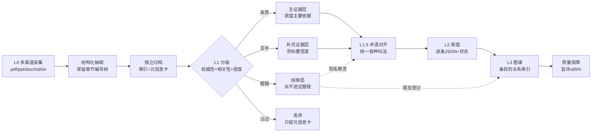

　　实线是证据流动的主流程，虚线是线索的受限通道：只能提供别名和待验证断言，永远当不了证据。

　　后面每个部分开头都放同一张总览缩略图，红框标注本部分在总流程中的位置，方便对照阅读。

### 第一部分：L0 采集建档

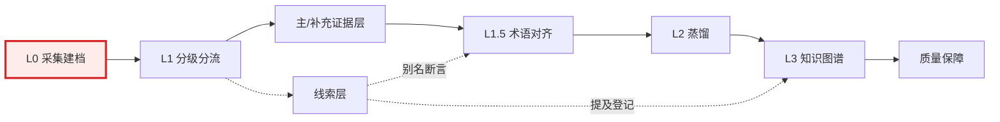

　　每篇文档一个独立文件夹，配目录索引和一张元信息卡。没有目录的文档等于不存在，目录是后续 LLM 定点读取的入口。元信息卡记录这篇文档是什么、谁出的、什么时候来的、被判去了哪一层，随流程生长，是文档在管道里的全生命周期档案，也让分级不必读全文。

　　元信息卡示例，逐字段带注释：

```yaml
doc_id: cae_ios_manual_v12          # 文档编号，全库唯一，后续所有引用和挂接都靠它
title: CAE A320 Neo IOS User Manual # 文档标题，按封面原文照抄
doc_type: 操作手册                  # 文档类型：操作手册/SDK文档/标准法规/培训材料/综述/播客转录/博客，权威性的直接判断依据
source_org: CAE                     # 出品机构（权威性的判断依据）
publish_date: 2023-06               # 出品方发布时间，判断版本新旧用
collect_date: 2026-08-01            # 收集入库的日期，版权出问题时能追账
language: en                        # 原文语种，语料语言定案的落点：生产动作只读原文
has_native_toc: true                # 是否自带原生目录，为 false 时由 LLM 补建目录
page_or_line_count: 487             # 篇幅规模（页数或行数）
```

### 第二部分：L1 分级分流

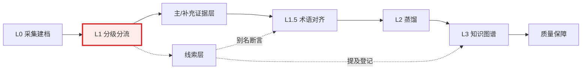

　　按权威性、相关性、信息密度三个维度打分，只看卡片、目录和 3~5 段抽样正文，不读全文。然后过一棵决策树：相关性达标吗？是官方操作级吗？有主证据层缺失的信息吗？三个问题答完，文档被分到四层之一：主证据层（每领域仅 1~2 份）、补充证据层、线索层、丢弃。

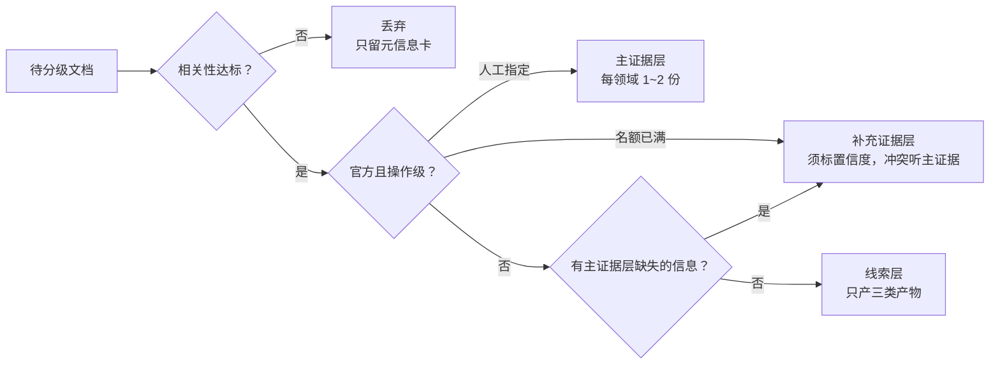

　　打分这件事本身也分三步交给机器：先纯人工判 50 篇攒出标注集，再让 LLM 照标注集预判、人抽查不低于 20%（错分率超 5% 就退回攒标注），最后把稳定特征固化成硬规则，LLM 只处理灰色地带。

　　标注前后元信息卡片示例，逐字段带注释：

```yaml
# 标注前（入库时登记，只有静态字段）
doc_id: cae_ios_manual_v12          # 文档编号，全库唯一
title: CAE A320 Neo IOS User Manual # 文档标题，按封面原文照抄
doc_type: 操作手册                  # 文档类型，权威性的直接判断依据
source_org: CAE                     # 出品机构
publish_date: 2023-06               # 出品方发布时间
collect_date: 2026-08-01            # 收集入库日期，合规追溯用
language: en                        # 原文语种
has_native_toc: true                # 是否自带原生目录
page_or_line_count: 487             # 篇幅规模

# — 以下是人工分级后回写的部分 —
triage:
  权威性: 官方                # 三维度打分之一，依据 doc_type 和 source_org
  相关性: 全文围绕目标软件     # 三维度打分之一，依据目录索引和抽样正文
  信息密度: 操作级            # 三维度打分之一，含逐参数操作表格即操作级
  分流: 主证据层              # 决策树结论：官方且操作级，人工指定
  分级人: 人工                # 本次分级由人执行（三步走的第一步为纯人工）
  分级日期: 2026-08-05        # 分级完成日期
  理由: 厂商官方手册，含逐参数操作表格  # 分级依据留痕，抽检与审计时回查
```

　　LLM 分级提示词示例，注释说明每段作用：

```text
# 文档分级提示词（示例片段）
你是文档分级员。请按以下标准给文档打分并分流：
1. 相关性低于"顺带提及" → 丢弃
2. 权威性 = 官方 且 信息密度 = 操作级 → 主证据层候选
3. ……（§3.2 决策树的文字版）     # 完整打分标准就是决策树，逐条写成文字

# 人工判过的例子（从标注集里挑出来的典型）
【例 1】输入：官方手册，含逐参数操作表格 → 输出：主证据层
【例 2】输入：第三方博客，只有功能感想 → 输出：线索层
# 少样本示例：让 LLM 照着人的判例打分，而不是凭空理解标准

# 现在请判断以下新文档的元信息卡和目录：
……                                # 此处拼接待分级文档的元信息卡和目录索引
```

　　规则固化后的判别特征，逐行带注释：

```python
# 稳定特征直接用规则判，不经过 LLM
if 含逐参数表格 and 出品机构 == 官方:
    分流 = "主证据层候选"          # 命中最强特征：官方出品且含逐参数表格
elif 文档类型 in ("播客转录", "博客"):
    分流 = "线索层"                # 命中明确的低权威特征，直接降级
else:
    交给 LLM 按预分级提示词判断     # 灰色地带：规则覆盖不了的才交给 LLM
```

### 第三部分：线索层（受限通道）

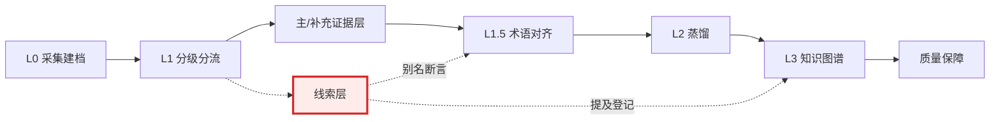

　　被判进线索层的粗糙文档不进证据链，但也不是垃圾。它们的价值在跨文档聚合，压成三份全局清单：概念提及清单（哪个词被多少篇提过）、断言日志（某文档声称 X 支持 Y，状态未验证）、检索词表（俗名缩写黑话）。三份清单里只有断言日志有验证语义，另外两份是单向输入，不参与校验：概念提及清单喂给术语对齐层当别名来源，检索词表用于下一轮收集扩词。

　　断言日志的校验是单向的：拿未验证断言回查权威层的文档原文（目录索引加全文检索），只有三个去处，证实就建证据条目，证伪就进冲突记录，查无就进盲区清单。即使断言被证实，条目出处也只写证据层章节，那篇博客永远上不了出处边。回查时机不阻塞主线蒸馏，攒到交付前的清单清算一并处理。清单的 YAML 和 JSONL 格式示例见主文档线索层一章。

### 第四部分：L1.5 术语对齐

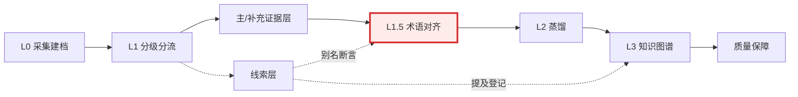

　　同一功能在不同文档叫法不同（Lesson Plan、课程计划、教案），不同功能也可能共用一词。对齐错误是管道里代价最高的错误：错合并把两个功能蒸成一个，错拆分把一个蒸成两个，都极难事后发现。

　　解决办法是一张全局术语登记表：每个概念一个规范名加若干别名，配一个永久编号 canonical\_id。LLM 抽出术语后先精确查表，查不到再语义判断。命中就映射到编号，没见过的新写法补登进别名。彻底未命中就由 LLM 提议新规范名，挂待仲裁，人工确认后才转正。蒸馏条目的术语字段只许填编号。铁律：合并类操作永远人工确认，宁可待仲裁，不可错合并。

　　术语登记表条目示例，逐字段带注释：

```yaml
- canonical_id: term_lesson_plan      # 这条术语的"身份证号"：全库唯一，分配后不再更改
                                      # 命名约定 = term_ + 英文小写短名（人看得懂即可，本身不承载语义）
                                      # 用途：蒸馏条目的术语字段、图谱的 ALIAS_OF 边都只准引用这个 id
                                      # （见 后续6.2、7.1），不引文档原词
  规范名: 课程计划 (Lesson Plan)      # 人类可读的正式叫法，以主证据文档的术语为准；日后可改，id 不受影响
  aliases: [教案, 训练课程, Lesson Plan Profile]  # 各文档里出现过的其他叫法；匹配时这些词都算命中本条目
  首次出处: {doc: cae_ios_manual, section: "7.1"}  # 第一次发现该术语的文档与章节，便于回查原文
  状态: 已确认                        # 已确认（人工拍板过）/ 待仲裁（LLM 提议、人工尚未确认）
  备注: Lesson Plan Profile 是独立工作区，与 Lesson Plan Tab 不同——曾发生同名异物误判
```

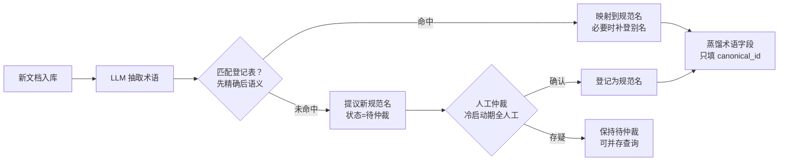

### 第五部分：L2 蒸馏

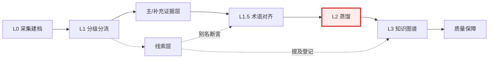

　　按预设骨架把主证据层和补充证据层逐条蒸成规格条目，每条一行 JSON，全局一份 entries.jsonl。骨架固定五类：功能点、UI 元素、流程、接口、约束规则。每类配一套字段，比如功能点填触发方式、输入范围、状态流转、关联依赖、异常边界。换领域时重设计类型清单和字段表。

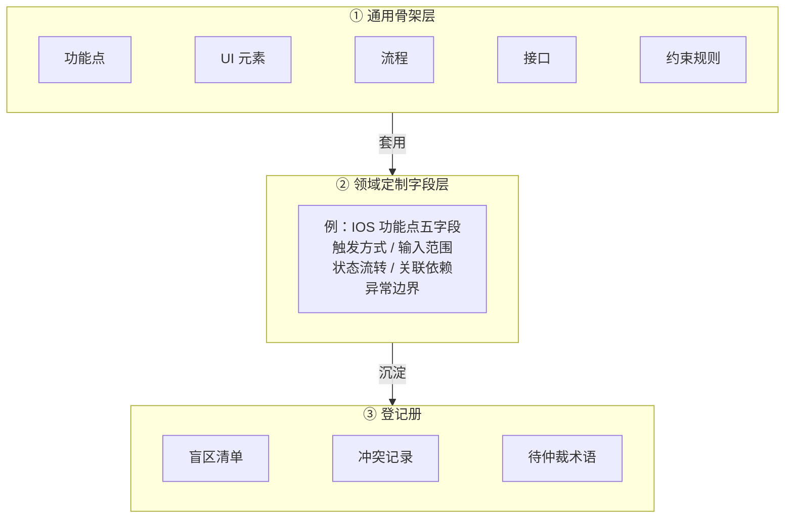

　　蒸馏时遇到当场解决不了的事不硬解也不放过，随手记进三份登记册：文档里查无的知识进盲区清单，两份文档说法打架进冲突记录，叫法拿不准进待仲裁术语。

　　冲突仲裁按双方身份定规矩：主证据对补充证据，主证据优先，主证据没提的以补充为准但置信度降一级。补充对补充，权威性高者优先，同级不擅自取舍，两条并存等人工仲裁。新证据对旧条目，旧条目不删除，用 supersedes 指向新条目，规格可演化，历史不抹除。核心不是选出正确答案，是每条结论出身和等级明确，解决不了的留痕可追账。


　　条目元字段结构


　　两份文档蒸出 5 条的示例

### 第六部分：L3 知识图谱

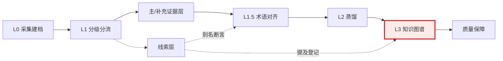

　　知识图谱不是语料仓库，是蒸馏产物的索引，像图书馆的卡片柜：书在文件夹里原样放着，卡片只记哪条知识出自哪本书哪一节、和谁有关、和谁打架。三种节点（文档章节、规格条目、术语），六种边（出处 SUPPORTS、术语 ALIAS\_OF、依赖 DEPENDS\_ON、触发 TRIGGERS、冲突 CONFLICTS\_WITH、提及 MENTIONS）。实线是确认的证据关系，虚线是未定论的线索关系。

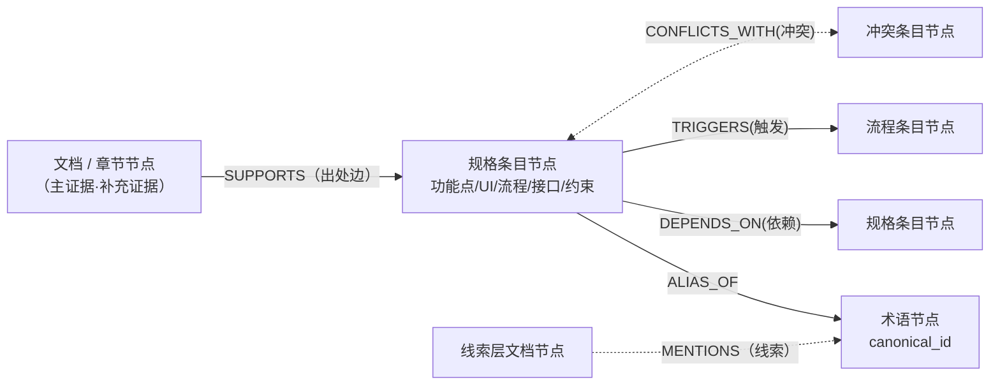

　　校验器强制四条非法结构规则：条目没有出处边即非法，出处是线索层文档即非法，条目没挂规范术语即非法，出处指向译文文件即非法。前三条是“线索不等于证据”的落点，第四条是语料语言定案的落点。


　　存储上初期严禁图数据库，JSONL 加 Git 加 grep、jq 就够跑全部查询。条目数超 5000 或要可视化探索时再迁 Neo4j。

### 第七部分：质量保障（贯穿全程）

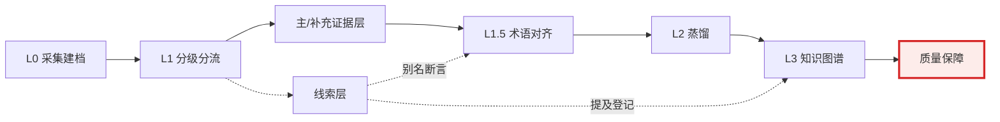

　　LLM 会犯错，而且错起来是批量地错，所以质量动作分散在整条时间线上。

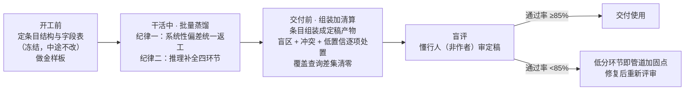

- 开工前：条目结构定稿冻结，先拿 1~2 份文档蒸出金样板，给 LLM 当示例、给人当验收尺子。
- 干活中两条纪律。发现某类条目普遍填错，先改规范再按版本号圈定范围统一返工，不哪里错改哪里。语料真缺但闭环必需时允许推理补全，但必须标假设、置信度最高为中、事后补到真证据要回验。
- 交付前：条目组装成定稿产物（软件规格书是其中一种），组装不产生新知识，相当于从数据库导报表。然后人工逐项清算盲区、冲突、低置信三份清单，最后找懂行但没参与蒸馏的人盲评，通过率低于 85% 打回，低分环节正好指出管道哪里要加固。

## 建成后的使用方式

　　日常是带着问题反查知识库，三类查询回答三个最常问的问题：

1. X 功能的完整规格是什么？LLM 把问题里的俗称翻译成规范编号，然后按编号做等值匹配捞条目，中间的取数没有 LLM、没有相似度，不漏不错捞。查无这个词本身就是情报：要么是新术语该登记，要么是知识库的盲区。
2. 哪些条目还不结实？按置信度低、单源支持、涉及冲突三个条件过滤。不结实不是质量问题，是亮明身份：补充层单源条目天生是中置信，推理补全的标假设，没仲裁完的冲突两条并存。随用随排，定期在里程碑集中清算。
3. 还有哪些章节没蒸？拿主证据全章节清单减去已蒸出处，差集只有两种合法归宿：补蒸，或登记盲区。不允许无声无息地跳过。这条是逐句覆盖原则的自动审计。

## 设计的可信性依据

- 每条结论带出处，出处落到章节级，能从任何一条结论查回原文对质。
- 置信度分级，猜的亮明身份，不许假装确定，也不许丢掉不确定的知识。
- 冲突留痕并存，机器不擅自拍板。
- 交付有盲评门槛挡着。

　　外部对照（主文档参考附录有逐条对照表）：法律电子证据开示的 TAR、情报界的 Admiralty 分级和 ICD 203、循证医学的 PRISMA 和 Cochrane、图书馆学的 Dublin Core 和 SKOS、语义网的 PROV 和 SHACL，各自独立验证过这套零件。本设计是把这些零件移植到“从文档逆向目标系统”的场景，并做了反 RAG 适配。零件几乎都有先例，组装方式是自己的，所以实际风险比看起来低。没有先例背书的几处（五类骨架、信息密度轴、85% 阈值）只能靠试点实测立起来。

## 待解决问题

　　主文档文末的 TODO 清单列了七个结构性问题，按优先级排：多媒体 source 模型（已定案推后）、目标软件的版本维度、条目层去重机制、别名补登的人工闸、逐条保真回链校验、补充证据层覆盖审计、信息密度按章节打分。其中 TODO-2 版本维度错了返工的是全局，TODO-3 到 TODO-5 决定规模化后知识库会不会悄悄烂掉。

## 与主文档的对照索引

- 产物字段与资产说明 → 主文档总体架构章
- 元信息卡字段 → 主文档采集层一章
- 分级打分细节与提示词 → 主文档分级层一章
- 三份线索清单的完整格式示例 → 主文档线索层一章
- 术语登记表接口与走查 → 主文档术语对齐层一章
- 条目元字段全表 → 主文档蒸馏层一章
- 图谱节点边定义与查询命令 → 主文档规格层一章
- 质量保障完整规则 → 主文档质量保障一章
- 先例对照全表与冷峻评估 → 主文档参考附录
- TODO 七项完整论证 → 主文档文末 TODO 清单
